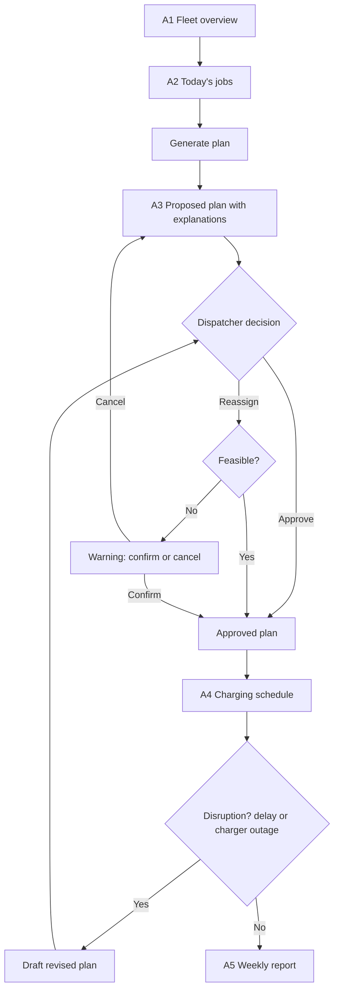
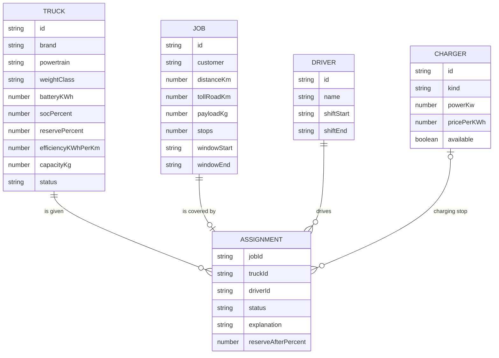

# product.md — VoltLane

**Course:** ESCP Business School, Bachelor in Management: Digital Transformation (Dr. David M. Lehmann), Berlin campus
**Team:** Bilegsain Khugjilt · Noélie Girardot Chaffard · Minghongyu (Echo) Li · Angilbert · Yasha · Zack
**Version:** v2, 5 Nov 2026

> Product Requirements Document, structured on Jesse James Garrett's *Elements of User Experience*: **1 Strategy → 2 Scope → 3 Structure → 4 Skeleton.** Layer 5 (Surface: visual design) is in `design.md`; technology choices are in `architecture.md`.
> IDs used across files: `KI-xx` key insight and `E-xx` evidence (evidence.md) · `UN-xx` user need · `PO-xx` product objective · `US-xx` user story · `FR-xx` functional requirement · `NFR-xx` non-functional requirement · `A1…` screen.

---

## 1. Strategy

### 1.1 Product in one sentence
**VoltLane is a web planning tool for dispatchers at trucking companies that run diesel and electric trucks side by side. It predicts how far each electric truck can safely go, proposes which jobs go electric and explains why, and fits charging around the depot and drivers' breaks, so expensive e-trucks drive as many kilometres as they safely can.**

### 1.2 Problem statement
Electric trucks in Europe go 11–19% further than their makers state (E-10), yet fleets charge them cautiously and buy bigger batteries than they use: 58% of charging sessions start while the battery is still over half full, and the average charging cycle uses only 44% of the battery (E-13). For companies that have run e-trucks for a year or more, the main problem is no longer the truck but **planning**: route-planning restrictions are their most-cited drawback (E-16). How the fleet is planned matters a lot: in a large REWE study, swapping diesels for e-trucks one for one let e-trucks drive 32% of fleet km, while re-planning the whole fleet raised this to 54% (E-18). In Germany, where e-trucks are toll-free until 30 June 2031 and already at cost parity with diesel (E-04, E-06), each kilometre given to a diesel that an e-truck could have driven is money lost.

### 1.3 Target users

| Role | Who | Relationship to product | Source |
|---|---|---|---|
| **Primary user** | Dispatcher ("Stefan") at a regional carrier running roughly 5–50 e-trucks alongside diesels, of more than one brand | Uses VoltLane daily to build and adjust the plan | evidence.md §5 |
| **Buyer** | Head of operations / fleet manager ("Claudia") | Pays; judged on cost per km and on-time delivery; reads the weekly report | evidence.md §5 |
| Secondary (not in prototype) | Drivers | Receive the plan; affected by charging stops and breaks | — |

**Market focus:** Germany first. It is the largest e-truck market, e-trucks there are toll-free until mid-2031, and they are already at cost parity (E-01, E-04, E-06). Netherlands and France next; together with Germany they account for 74% of EU e-truck registrations (E-01).

**First use case:** regional, multi-stop distribution returning to a depot. ICCT measured the largest range surplus here (+19%, E-10), and depot charging covers most energy needs (E-22).

**Honest sizing note:** most adopters run only about 5 e-trucks today (E-26), and e-trucks are ~0.3% of all trucks (E-02). Our target group (5–50 e-trucks, mixed brands) is small now and grows as fleets scale towards 2030.

### 1.4 User needs

| ID | User need | For whom | From insight |
|---|---|---|---|
| UN-01 | Know **how far each e-truck can safely go today** with this load and weather, and **how sure** that estimate is | Dispatcher | KI-01 |
| UN-02 | Get **one plan for the whole mixed fleet**, across truck brands, that puts suitable jobs on e-trucks first | Dispatcher | KI-02 |
| UN-03 | **Understand and override** every suggestion, so he stays responsible and in control | Dispatcher | KI-03 |
| UN-04 | Have **charging fitted into depot time and legal driver breaks**, with no surprise stops | Dispatcher | KI-04 |
| UN-05 | **Re-plan quickly** when an order is added or a delivery runs late, taking remaining range into account | Dispatcher | KI-02 (E-19) |
| UN-06 | **See whether the e-trucks pay off**: e-km driven vs. possible, toll saved, energy cost vs. diesel | Head of ops | KI-05 |

### 1.5 Product objectives (business goals)

| ID | Objective | Why it matters to VoltLane |
|---|---|---|
| PO-01 | **Increase the share of fleet km driven electric** at each customer | This is the value we sell; it drives renewal and growth (we charge per e-truck) |
| PO-02 | **Earn dispatcher trust**, so suggestions get accepted rather than ignored | Expected dispatcher scepticism is a main adoption risk (E-17) |
| PO-03 | **Prove the return** to the buyer within the 90-day trial | The trial has to turn into an annual contract |
| PO-04 | **Fit into the daily routine**, so planning with VoltLane is no slower than without it | Otherwise dispatchers fall back to Excel and phone |

### 1.6 Success metrics

| Metric | Target | Linked to |
|---|---|---|
| Share of fleet km driven electric, vs. the customer's own baseline measured before VoltLane | **+20% relative** within the 90-day trial | PO-01, UN-02 |
| Electric km per e-truck per working day, vs. baseline | **+20%**, with **zero** range-related breakdowns or missed deliveries | PO-01, UN-01 |
| Share of VoltLane suggestions accepted without changes | **≥ 70%** after 4 weeks | PO-02, UN-03 |
| Time to build the next day's plan | **No more than the customer's current time** (measured in week 1) | PO-04 |
| Head of ops opens the weekly report | **At least 3 of 4 weeks** each month | PO-03, UN-06 |
| Trial → annual contract conversion | **≥ 50%** | PO-03 |

*All targets are our assumptions, to be tested in pilots. The +20% matches our pitch deck's 2028 milestone ("trucks drive 20% more electric km").*

### 1.7 Value proposition
- **For the dispatcher:** "Plan the whole fleet at once, know which jobs your e-trucks can safely do, and see why."
- **For the head of operations:** "Get your e-trucks driving as much as they safely can, and see the savings every week."

### 1.8 Positioning vs. alternatives

| Alternative | What it does well | Gap VoltLane targets |
|---|---|---|
| Excel + experience | Flexible, familiar | No range prediction; e-trucks tend to get the "safe" jobs |
| Truck makers' own tools (Volvo Range & Route, Mercedes Fleetboard, MAN) | Accurate data for their own trucks; partly free with a new truck (E-27) | One brand each; no plan for a mixed fleet |
| Route-planning software (PTV, HERE) | Route optimisation, now with e-truck profiles (E-20, E-28) | Built around routes, not around the question "which jobs should go electric?" |
| AI planning platforms (Einride) | Fleet-level planning with proven results (E-18) | Mostly sold with Einride's own trucks and transport service; less aimed at independent carriers' own dispatch |
| E-truck charging coordination (FRYTE Mobility, €5M raised) | Planning and booking of charging stops for dispatchers (E-28) | Focus on charging and booking, less on job assignment and ROI reporting |
| Telematics (Geotab, Webfleet) | Collect data, monitor battery level | Monitor rather than plan; partners and data sources for us |

**Where we differentiate:** the **e-km decision** (which jobs go electric) across **all truck brands**, combined with **explained suggestions** the dispatcher can trust and override, and a **weekly ROI report** for the buyer. Charging *booking* is not our core; we would rather partner with charging-booking platforms.
*Assumption to test:* that Einride's and FRYTE's current offers do not already cover this combination for independent mid-size carriers.

### 1.9 Constraints and scope boundaries
- **Platform:** desktop web app (dispatchers work at a desk). No mobile app in v1.
- **Prototype rules (course):** **no external APIs and no real data**. Trucks, jobs, chargers and drivers are **mock data**. The "AI" is simulated with transparent rules (e.g. a job fits if its distance, adjusted for load and temperature, plus a safety buffer is below the truck's predicted range).
- **Not in scope:** turn-by-turn navigation for drivers, live charger booking, billing, hydrogen trucks, cross-border long-haul.
- **Regulatory:** plans must respect EU driving and rest rules (Reg. 561/2006: 45-minute break after 4.5 h of driving) (E-21).

### 1.10 Key assumptions and risks (Strategy level)

| Risk | Mitigation | Evidence |
|---|---|---|
| Dispatchers ignore suggestions | Explain every suggestion; make override easy; track the acceptance rate | KI-03, E-17 |
| Range prediction wrong → stranded truck | Visible safety buffer; cautious by default; learns per truck | KI-01, E-11 |
| Target market small today (most adopters ~5 e-trucks) | Target fleets that are scaling up; validate the segment in interviews | E-02, E-26 |
| Truck makers' free tools are "good enough" | Focus on mixed-brand fleets; test in interviews (A2) | E-27 |
| Funded competitors (Einride, FRYTE, PTV) move into the same space | Differentiate on e-km decision + explainability + ROI; partner on charging | E-28 |
| Price above category norms (pitch: €180 per e-truck per month vs. typical $20–60 per vehicle) | Test willingness to pay (A4); toll savings alone justify it only for heavy trucks | E-05, E-29, evidence.md §7 |
| Toll advantage shrinks after June 2031 | Lower energy costs still favour e-trucks; EU rules still allow up to a 75% discount | E-04, E-06 |

### 1.11 Traceability (Strategy → Evidence)

| User need | Key insight | Evidence |
|---|---|---|
| UN-01 | KI-01 | E-05, E-10, E-11, E-12, E-13, E-14 |
| UN-02 | KI-02 | E-01, E-02, E-16, E-18, E-20 |
| UN-03 | KI-03 | E-17, E-20, E-25 |
| UN-04 | KI-04 | E-07, E-08, E-15, E-21, E-22, E-23 |
| UN-05 | KI-02 | E-19 |
| UN-06 | KI-05 | E-06, E-24, E-25 |

---

## 2. Scope

The prototype covers **8 user stories** across 5 screens. Everything runs on fictional data with no external APIs (§1.9).

### 2.1 Functional specifications

| # | User story | Functional requirements | Non-functional requirements | Screens |
|---|---|---|---|---|
| US-01 | As a dispatcher, I want to see each truck's battery level, predicted range and safety reserve, so I know which jobs each e-truck can safely do. *(UN-01)* | **FR-01** The system must list all trucks with brand, powertrain, weight class and status. **FR-02** For each e-truck, the system must show battery level (%), usable energy above the reserve (kWh) and predicted range (km). **FR-03** Predicted range must adjust for temperature and load. | **NFR-01** Range is always labelled as an estimate. **NFR-02** Status is shown with text and icon, never colour alone. | A1 |
| US-02 | As a dispatcher, I want to see today's jobs with distance, load and time window, so I can judge what needs planning. *(UN-02)* | **FR-04** The system must list jobs with distance, toll-road km, payload, stops and time window. **FR-05** The dispatcher must be able to sort jobs by distance and time window. | — | A2 |
| US-03 | As a dispatcher, I want one plan for the whole mixed fleet that puts suitable jobs on e-trucks first, so the e-trucks drive as much as they safely can. *(UN-02)* | **FR-06** The system must generate a proposed plan for all jobs with one action. **FR-07** Jobs are matched longest first to the feasible e-truck with the smallest remaining margin (architecture.md §7). **FR-08** Jobs no e-truck can do go to diesel trucks. | **NFR-03** A plan for up to 50 jobs is generated in under 2 seconds. | A3 |
| US-04 | As a dispatcher, I want to see why each truck was suggested, so I can trust or question the plan. *(UN-03)* | **FR-09** Each proposal must show energy needed, energy available and battery reserve on arrival. **FR-10** Each job not given to an e-truck must show the reason (range, payload or availability). | **NFR-04** Explanations are one sentence in plain language, without technical jargon. | A3 |
| US-05 | As a dispatcher, I want to approve or change any suggestion, so I stay in control of the final plan. *(UN-03)* | **FR-11** The dispatcher must be able to approve one proposal or all of them. **FR-12** The dispatcher must be able to reassign a job to another truck. **FR-13** If a reassignment is not feasible, the system must warn and ask for explicit confirmation. | **NFR-05** Proposed and approved assignments always look different. | A3 |
| US-06 | As a dispatcher, I want charging planned in depot time and drivers' legal breaks, so charging doesn't add extra stops. *(UN-04)* | **FR-14** The system must schedule depot charging first. **FR-15** Public charging may only be planned inside a 45-minute driver break. **FR-16** The system must flag any charging that would end after the driver's shift. | **NFR-06** Break rules follow Reg. 561/2006 (45 min after 4.5 h of driving). | A4 |
| US-07 | As a dispatcher, I want to re-plan quickly when a delivery runs late or a charger fails, so the day stays on track. *(UN-05)* | **FR-17** The dispatcher must be able to trigger a simulated delay or charger outage. **FR-18** The system must draft a revised plan that again requires approval. | **NFR-07** A re-plan never changes approved assignments without confirmation. | A3, A4 |
| US-08 | As a head of operations, I want a weekly report on e-truck use and savings, so I can see whether the e-trucks pay off. *(UN-06)* | **FR-19** The report must show e-km driven, share of fleet km driven electric, and e-km possible vs. driven. **FR-20** The report must estimate toll saved using the rate for each truck's weight class. **FR-21** The report must compare energy cost with a diesel equivalent. | **NFR-08** All figures are labelled as estimates based on fictional data. | A5 |

**Requirements for the whole prototype**
- **NFR-09** No external APIs and no real data; all data comes from local seed files.
- **NFR-10** Desktop-first layout, at least 1280 px wide.
- **NFR-11** Keyboard-operable controls and WCAG AA contrast.
- **NFR-12** Plans persist in the browser; a **Reset demo** button restores the seed data.

### 2.2 Content requirements

| Content | Where | Source / owner |
|---|---|---|
| 8 fictional trucks (5 electric across 2 brands, 3 diesel) | A1 | `seedData.ts` |
| 6–12 fictional jobs for one working day | A2, A3 | `seedData.ts` |
| Depot and public chargers with power and price | A4 | `seedData.ts`; prices from E-22 |
| Explanation sentences (feasible, infeasible, overridden) | A3 | Text templates in `planner.ts` |
| One fictional past week of approved assignments | A5 | `seedHistory.ts` |
| Toll rates and energy prices | A5 | `constants.ts`; values from E-05, E-22 |
| Short glossary: battery level, reserve, e-km share | Tooltips | design.md |

### 2.3 Out of scope for the prototype
Real maps and routing, live charger booking, login and user roles, multiple depots, driver app, billing.

## 3. Structure

### 3.1 Interaction design: daily planning flow



**Key interaction rules**
- The system **proposes**; only the dispatcher **approves** (UN-03, KI-03).
- Every re-plan returns to the decision step; nothing changes silently (NFR-07).
- An infeasible choice is allowed but never hidden: it needs explicit confirmation (FR-13).

### 3.2 Information architecture

**Navigation:** a left sidebar with five items in working order: *Fleet (A1) → Jobs (A2) → Daily plan (A3) → Charging (A4) → Weekly report (A5)*. A top bar shows the date, the scenario (temperature) and the **Reset demo** button.

**Data model** (matches architecture.md §5):



Each job has at most one assignment; a truck and a driver can have several per day; an assignment may include one charging stop.

## 4. Skeleton

Low-fidelity wireframes for the five screens. Visual styling (colour, type, components) is in `design.md`.

**Figma wireframes (A1–A5, desktop 1440 × 900):** [VoltLane — Skeleton wireframes](https://www.figma.com/design/rUYDqDUAa8etl3w6t6hFu9)

The Figma file is the visual reference; the text wireframes below describe the same screens for the coding agent.

### 4.1 Navigation design
- **Sidebar (always visible):** VoltLane logo · Fleet (A1) · Jobs (A2) · Daily plan (A3) · Charging (A4) · Weekly report (A5). The active item has a lime marker.
- **Top bar:** today's date · scenario (temperature, active events) · **Reset demo**.
- **Main route through the app:** A1 → A2 → A3 (core screen) → A4 → A5. Every screen is also reachable directly from the sidebar.

### 4.2 Interface and information design per screen

**A1 Fleet overview** (US-01)
```text
┌──────────┬──────────────────────────────────────────────────────────────┐
│ VoltLane │ Thu 5 Nov · 4 °C · no events                   [Reset demo]  │
│          ├──────────────────────────────────────────────────────────────┤
│ ▌Fleet   │ Fleet overview                       8 trucks · 5 electric   │
│  Jobs    │ ┌──────┬────────┬──────────┬───────┬─────────────────┬──────┐│
│  Plan    │ │Truck │ Brand  │ Type     │ Class │ Battery / range │Status││
│  Charging│ ├──────┼────────┼──────────┼───────┼─────────────────┼──────┤│
│  Report  │ │ E-01 │ Brand A│ ⚡Electric│ >18 t │ ████████░ 82%   │Avail.││
│          │ │      │        │          │       │ ~255 km (±est.) │      ││
│          │ │ E-02 │ Brand B│ ⚡Electric│7.5–12t│ ███░░░░░░ 34% ⚠ │Charg.││
│          │ │ D-01 │ Brand A│ Diesel   │ >18 t │ —               │Avail.││
│          │ └──────┴────────┴──────────┴───────┴─────────────────┴──────┘│
└──────────┴──────────────────────────────────────────────────────────────┘
```

**A2 Today's jobs** (US-02)
```text
│ Today's jobs                     8 jobs · 612 km total    Sort: [Distance ▾] │
│ ┌──────┬───────────────────────┬────────┬────────┬───────┬──────────────┐  │
│ │ Job  │ Route (fictional)     │ km     │ Load   │ Stops │ Time window  │  │
│ │ J-04 │ Dortmund → Bochum     │ 148    │ 6.2 t  │ 3     │ 07:00–11:00  │  │
│ │ J-07 │ Dortmund → Münster    │ 182    │ 8.4 t  │ 2     │ 08:00–14:00  │  │
│ └──────┴───────────────────────┴────────┴────────┴───────┴──────────────┘  │
│                                                       [ Generate plan → ]   │
```

**A3 Daily plan, core screen** (US-03, US-04, US-05, US-07)
```text
│ Daily plan          6 of 8 jobs electric (75% of km)   [Approve all feasible]│
│ Scenario: [Delay J-02] [Charger outage] [Cold −5 °C]                         │
│ ┌ - - - - - - - - - - - - - - - - - - ┐ ┌──────────────────────────────────┐ │
│   PROPOSED · J-04 → E-03 ⚡  ● Feasible  │ ✓ APPROVED · J-01 → E-01 ⚡       │ │
│   "Needs 182 kWh, has 236 kWh above     │ Arrives with 31% left.           │ │
│    reserve; arrives with 23% left."     └──────────────────────────────────┘ │
│   [Approve] [Reassign…]                 ┌──────────────────────────────────┐ │
│ └ - - - - - - - - - - - - - - - - - - ┘ │ ✕ J-07 → D-02 Diesel             │ │
│                                         │ "Too heavy for free e-trucks      │ │
│                                         │  (8.4 t vs 7.0 t)."              │ │
│                                         └──────────────────────────────────┘ │
```
Proposed cards (dashed) and approved cards (solid, dark) are visually separate. A disruption creates new proposed cards; approved ones stay unchanged until confirmed.

**A4 Charging** (US-06)
```text
│ Charging schedule — Depot Dortmund (fictional)                               │
│ 06:00     08:00     10:00     12:00     14:00     16:00     18:00            │
│ E-01 ████ depot                          ▒▒ break charge (public, 45 min)    │
│ E-02 ██████████ depot                                                         │
│ E-05                      ▒▒ public, in break       ⚠ ends after shift       │
│ Legend: ████ depot  ▒▒ public in driver break  ⚠ needs attention            │
```

**A5 Weekly report** (US-08)
```text
│ Weekly report · week 45 (fictional data, estimates)                          │
│ ┌────────────┐ ┌────────────┐ ┌────────────┐ ┌──────────────────┐           │
│ │ 3,420 km   │ │ 58%        │ │ € 1,010    │ │ € 640            │           │
│ │ electric   │ │ of fleet km│ │ toll saved │ │ energy vs diesel │           │
│ │ +18% vs wk │ │ electric   │ │ (est.)     │ │ (est.)           │           │
│ └────────────┘ └────────────┘ └────────────┘ └──────────────────┘           │
│ Per truck: e-km driven vs possible                                           │
│ E-01 ███████████████░░░  412 / 480 km                                        │
│ E-02 ████████░░░░░░░░░░  220 / 455 km   ← under-used                          │
```
All report figures are illustrative examples from fictional data.
